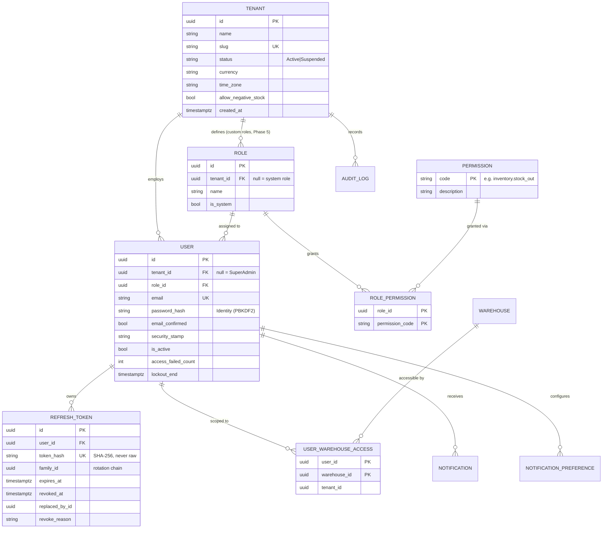
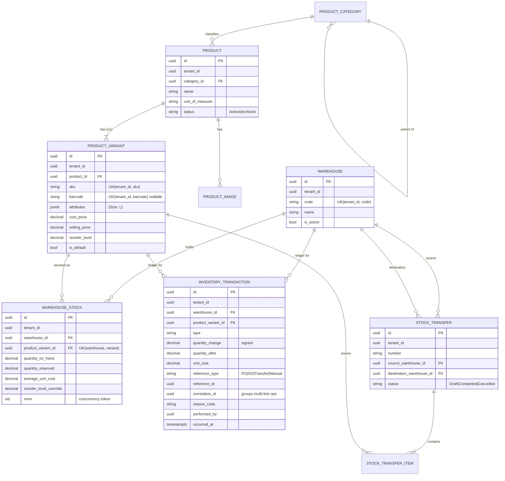
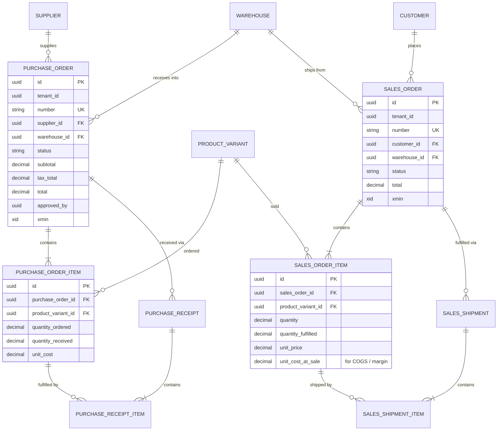

# StockPilot — Phase 1: Project Planning

> Status: **Draft — awaiting approval** · Date: 2026-11-09
> Scope: architecture, data model, API surface, permissions, roadmap. No implementation code.

---

## 0. Assumptions & Key Decisions (read this first)

These are the decisions that shape everything else. Items marked **[CONFIRM]** change architecture or business behaviour — please confirm or correct them before Phase 2.

| # | Decision | Why |
|---|----------|-----|
| A1 | **[CONFIRM]** One user belongs to exactly one company (`User.TenantId`). Super Admin has no tenant. | Covers SMB use. Multi-company membership (one login, several companies) needs a membership table plus a tenant switcher, and is rarely needed here. It can be added later without rewriting tenancy. |
| A2 | **[CONFIRM]** Inventory is valued at **weighted average cost** per variant per warehouse. | Simple, auditable, and standard for SMBs. FIFO needs cost layers and is listed as advanced. |
| A3 | **[CONFIRM]** MVP ships **fixed system roles** (Owner, Manager, Inventory Staff, Sales Staff) backed by a real permission table. Custom per-company roles come in Phase 5. | The data model supports custom roles from day one. Only the "create custom role" UI is deferred. |
| A4 | **[CONFIRM]** Stock is tracked at the **variant** level. Every product has at least one variant, created automatically as the default variant. | One code path for products with and without variants. No `if (hasVariants)` branches. |
| A5 | **[CONFIRM]** Sales orders reserve stock on **Confirm** and deduct it on **Fulfil**. Cancelling releases the reservation. | Prevents overselling between order entry and shipping. |
| A6 | **[CONFIRM]** Single currency per company (set at registration). Quantities are `numeric(18,3)` so they support kg and litres. Money is `numeric(18,4)`. | Multi-currency adds FX tables and rounding rules that the portfolio doesn't need. |
| A7 | A minimal **Customer** entity is added (not in your list). | Sales orders need a buyer. A "Walk-in customer" is seeded per tenant. |
| A8 | **Shared database, shared schema, `TenantId` column** multi-tenancy. | Fits Neon's free tier (one database). It is also the most common SaaS model and the strongest portfolio story when done right. |
| A9 | **No MediatR, AutoMapper or FluentAssertions.** | All three moved to commercial licences in 2025. We use plain handler classes, manual mapping and EF projections, and xUnit with Shouldly. This is also less magic, which helps learning. |
| A10 | **Controllers** (thin) in the API layer, **React Router** on the frontend. | Controllers organise filters and attributes clearly for a learner. You didn't name a router, and React Router is the most widely used. |
| A11 | Super Admin **cannot read tenant business data** (products, orders and so on). They see only company metadata and aggregate platform metrics. | Least privilege. Support impersonation is an audited, advanced feature. |

**Missing input:** you mentioned an attached dashboard reference image, but no image came through. Please attach it before Phase 3 (frontend). It doesn't block Phase 2.

**Local toolchain:** Node v24 is installed. **.NET 10 SDK and Docker Desktop are not installed.** Both are needed for Phase 2: Docker runs PostgreSQL, Redis and Mailpit locally and powers the Testcontainers integration tests. The folder is also not a git repository yet, and Phase 2 starts with `git init`.

---

## 1. System Architecture

### 1.1 Deployed topology

```
                          ┌──────────────────────────────────────────┐
   Browser (React SPA)    │ Cloudflare Pages  (static assets, free)  │
   ───────────────────────►  app.<name>.pages.dev                    │
        │                 │  └─ Pages Function: /api/*  ──► proxy ───┼──┐  (same-origin → refresh cookie works in Safari)
        │                 └──────────────────────────────────────────┘  │
        │  WebSocket (SignalR, token in query string)                   │
        ▼                                                               ▼
 ┌─────────────────────────────────────────────────────────────────────────────┐
 │ Render Free Web Service — Docker container (ASP.NET Core, .NET 10)          │
 │  ┌──────────────┐  ┌───────────────┐  ┌───────────┐  ┌────────────────────┐ │
 │  │ REST API     │  │ SignalR Hub   │  │ Hangfire  │  │ Serilog → stdout   │ │
 │  │ (controllers)│  │ /hubs/notify  │  │ server    │  │ (Render log view)  │ │
 │  └──────┬───────┘  └──────┬────────┘  └─────┬─────┘  └────────────────────┘ │
 └─────────┼─────────────────┼─────────────────┼───────────────────────────────┘
           │                 │                 │
   ┌───────▼───────┐  ┌──────▼───────┐  ┌──────▼──────────┐  ┌────────────────┐
   │ Neon Postgres │  │ Upstash Redis│  │ Cloudflare R2   │  │ Resend (email) │
   │ (free, pooled)│  │ (optional)   │  │ (product images)│  │ (optional)     │
   └───────────────┘  └──────────────┘  └─────────────────┘  └────────────────┘
```

**Local development (`docker compose up`):** postgres:17, redis:7, mailpit (fake SMTP inbox at http://localhost:8025), the API, and the Vite dev server. Hangfire uses PostgreSQL storage. Files go to a local `uploads/` folder through the same `IFileStorage` interface.

### 1.2 Clean Architecture — dependency rule

```
   ┌─────────────────────────────────────────────┐
   │  API  (controllers, middleware, auth, DI)   │──┐
   └───────────────┬─────────────────────────────┘  │ references
                   ▼                                ▼
   ┌─────────────────────────────┐   ┌──────────────────────────────────┐
   │  Application                │◄──│  Infrastructure                  │
   │  use cases, DTOs, validators│   │  EF Core, Identity, Redis, R2,   │
   │  interfaces (ports)         │   │  email, Hangfire, SignalR sender │
   └───────────────┬─────────────┘   └──────────────────────────────────┘
                   ▼
   ┌─────────────────────────────┐
   │  Domain                     │   ← no dependencies on anything
   │  entities, enums, rules,    │
   │  domain exceptions          │
   └─────────────────────────────┘
```

- **Domain** knows nothing about EF, HTTP or JSON. Example: `WarehouseStock.Deduct(qty, allowNegative)` throws `InsufficientStockException`.
- **Application** defines *what* happens. Example: `FulfilSalesOrderHandler` loads the order, locks stock rows, calls domain methods, writes the ledger and commits. It depends on interfaces such as `IAppDbContext`, `ICurrentUser`, `IClock` and `INotificationPublisher`.
- **Infrastructure** defines *how* those interfaces are implemented (Npgsql, StackExchange.Redis, the S3 SDK for R2).
- **API** turns HTTP into application calls and back. Controllers have no business logic: they authorise, call a handler, and map the result to a status code.

**Mentor note — repositories.** EF Core's `DbContext` already is a unit of work and `DbSet<T>` already is a repository. Wrapping every entity in `IProductRepository` adds code without adding value. Instead, Application depends on an `IAppDbContext` interface that exposes the `DbSet`s. This is a pragmatic, widely used Clean Architecture variant. We add a dedicated abstraction only where it earns its place, for example `IStockLockService` for the raw `SELECT … FOR UPDATE`.

### 1.3 Request lifecycle (how data flows)

Example: an Inventory Staff user records a stock-out.

```
React form (RHF + Zod validates shape)
  → TanStack Query mutation → axios POST /api/v1/inventory/stock-out
     headers: Authorization: Bearer <access JWT>, Idempotency-Key: <uuid>
  → [Pages Function proxy] → Render
  → Middleware pipeline: Serilog request log → exception handler → CORS → rate limiter
       → authentication (validate JWT) → TenantContext (tid claim) → authorization
  → [Authorize(Permission.InventoryStockOut)] + resource check (user assigned to warehouse?)
  → Controller → StockOutHandler
       1. FluentValidation (server re-validates; never trust the client)
       2. Idempotency check (key seen before → return stored result)
       3. BEGIN TRANSACTION
       4. SELECT … FROM warehouse_stock WHERE … FOR UPDATE   (row lock)
       5. domain: stock.Deduct(qty)  → throws if insufficient
       6. INSERT inventory_transaction (ledger row, quantity_after)
       7. SaveChanges → audit interceptor writes audit_log; tenant interceptor stamps TenantId
       8. COMMIT
       9. after commit: low-stock check → notification row + SignalR push
  → 200 + DTO  →  TanStack Query invalidates ['inventory', …] → UI refreshes, toast shown
```

---

## 2. Folder Structure

```
StockPilot/
├─ backend/
│  ├─ StockPilot.slnx
│  ├─ Directory.Build.props          # shared: net10.0, nullable, warnings-as-errors, analyzers
│  ├─ Directory.Packages.props       # central package version management
│  ├─ src/
│  │  ├─ StockPilot.Domain/
│  │  │  ├─ Common/                  # Entity base, ITenantOwned, IAuditable, DomainException
│  │  │  ├─ Tenancy/  Identity/  Catalog/  Warehousing/  Inventory/
│  │  │  ├─ Purchasing/  Sales/  Notifications/  Auditing/
│  │  │  └─ (each: entities, enums, domain exceptions, invariants)
│  │  ├─ StockPilot.Application/
│  │  │  ├─ Common/                  # interfaces (IAppDbContext, ICurrentUser, IClock…),
│  │  │  │                           # Result<T>, PagedResult<T>, ValidationBehavior, Permissions
│  │  │  └─ Features/                # vertical slices
│  │  │     ├─ Auth/  Products/  Inventory/  Warehouses/  Suppliers/
│  │  │     ├─ Purchasing/  Sales/  Reports/  Notifications/  Settings/  Platform/
│  │  │     └─ e.g. Products/CreateProduct/{CreateProductCommand, Handler, Validator}.cs
│  │  ├─ StockPilot.Infrastructure/
│  │  │  ├─ Persistence/             # AppDbContext, Configurations/, Migrations/, Interceptors/, Seed/
│  │  │  ├─ Identity/                # Identity setup, JwtTokenService, RefreshTokenService
│  │  │  ├─ Caching/  Storage/  Email/  BackgroundJobs/  Realtime/
│  │  │  └─ DependencyInjection.cs
│  │  └─ StockPilot.API/
│  │     ├─ Controllers/  Middleware/  Authorization/  Hubs/
│  │     ├─ Program.cs  appsettings.json  appsettings.Development.json
│  │     └─ Dockerfile
│  └─ tests/
│     ├─ StockPilot.UnitTests/          # domain + handlers, no Docker needed, fast
│     └─ StockPilot.IntegrationTests/   # WebApplicationFactory + Testcontainers Postgres
├─ frontend/
│  ├─ src/
│  │  ├─ app/                 # router, providers (QueryClient, Theme), layouts
│  │  ├─ components/
│  │  │  ├─ ui/               # shadcn primitives (owned code)
│  │  │  └─ shared/           # DataTable, MetricCard, PageHeader, EmptyState, ConfirmDialog…
│  │  ├─ features/            # mirrors backend features
│  │  │  └─ products/{api/, components/, hooks/, schemas/, pages/}
│  │  ├─ lib/                 # api-client (axios + refresh interceptor), query-keys, utils
│  │  ├─ stores/              # Zustand: auth-store, ui-store (sidebar, theme)
│  │  ├─ types/api.gen.ts     # GENERATED from OpenAPI — never hand-edit
│  │  └─ test/                # MSW handlers, test utils
│  ├─ e2e/                    # Playwright critical-flow tests
│  └─ functions/api/[[path]].ts  # Cloudflare Pages Function proxy
├─ docs/                      # this file, ERD, ADRs, deployment guide
├─ .github/workflows/         # ci.yml, deploy.yml
├─ docker-compose.yml
├─ .env.example
└─ README.md
```

**Deviation from your layout:** I split `StockPilot.Tests` into **UnitTests** and **IntegrationTests**. Integration tests need Docker and take tens of seconds, while unit tests run in about a second. Keeping them separate keeps the inner loop fast, and CI runs both.

**API contract sync (rule 13):** the backend generates OpenAPI and `openapi-typescript` produces `types/api.gen.ts`. CI fails if the generated file is stale, so frontend and backend cannot drift silently.

---

## 3. Database ERD

Conventions:
- PostgreSQL with `snake_case` names (EFCore.NamingConventions).
- PKs are **UUID v7** (`Guid.CreateVersion7()`). They are time-ordered, so B-tree indexes stay efficient, and they are non-guessable, which adds defence-in-depth against IDOR.
- All timestamps are `timestamptz` in UTC.
- Business documents also have human-readable numbers (`PO-2026-00042`) issued from a per-tenant `tenant_sequence`.
- 🔒 = has `tenant_id` and an EF global query filter.

### 3.1 Tenancy, identity & access



### 3.2 Catalog, warehouses & inventory



### 3.3 Purchasing & sales



### 3.4 Supporting tables

| Table | Purpose |
|---|---|
| `notification` 🔒 | `recipient_user_id`, `type`, `title`, `message`, `entity_type/entity_id` (deep link), `read_at` |
| `notification_preference` 🔒 | per user × type: `in_app`, `email` |
| `audit_log` | `tenant_id` (nullable for platform actions), `user_id`, `action`, `entity_type`, `entity_id`, `changes jsonb` (old→new), `ip`, `correlation_id`, `occurred_at`. **Append-only.** |
| `idempotency_record` 🔒 | `UK(tenant_id, key)`, `request_hash`, `response_status`, `response_body jsonb`, `expires_at` |
| `tenant_sequence` 🔒 | `(tenant_id, name)` → `next_value`, used for PO/SO/TR numbers (row-locked increment) |
| `product_image` 🔒 | `storage_key`, `content_type`, `size_bytes`, `sort_order`, `is_primary` |
| `customer` 🔒 | `name`, `email`, `phone`, `address` |
| `supplier` 🔒 | `code`, `name`, `contact_name`, `email`, `phone`, `address`, `payment_terms_days`, `is_active` |
| Hangfire tables | separate `hangfire` schema, managed by Hangfire |

### 3.5 Relationship explanations

- **Tenant → everything (1:N).** Every business row carries `tenant_id`. Child rows such as `purchase_order_item` belong to their parent aggregate. They also carry `tenant_id` so that reports can filter them directly and query filters cover them.
- **Product → ProductVariant (1:N, at least 1).** A variant is the sellable, stockable unit with its own SKU, barcode and prices. A T-shirt product has variants S/M/L. A simple product has one default variant.
- **Warehouse × Variant → WarehouseStock (M:N, with payload).** This is the *current balance*, one row per pair. It's a materialised snapshot that exists for fast reads.
- **InventoryTransaction is the source of truth.** It's an append-only ledger. `SUM(quantity_change)` per warehouse and variant must always equal `quantity_on_hand`, and an integration test plus a nightly Hangfire reconciliation job verify this. Ledger rows are never updated or deleted. Mistakes are corrected with a compensating adjustment.
- **PurchaseOrder → PurchaseReceipt (1:N).** Each receiving event is its own document, which is what makes *partial receiving* auditable ("received 40 on Nov 3, 60 on Nov 10"). `purchase_order_item.quantity_received` is the running total.
- **SalesOrder → SalesShipment (1:N).** Mirrors purchasing, so partial fulfilment works the same way.
- **StockTransfer → StockTransferItem.** One transfer writes **two** ledger rows per item (`TransferOut` at the source, `TransferIn` at the destination) inside **one** database transaction, sharing a `correlation_id`.
- **User → Role (N:1), Role ↔ Permission (M:N).** Authorisation checks *permissions*, never role names, so custom roles later need no code changes.
- **User ↔ Warehouse (M:N) via `user_warehouse_access`.** Restricts Inventory Staff to their assigned warehouses. An empty set for Owner or Manager means "all".
- **Soft delete.** Products, variants, warehouses, suppliers and customers are *archived* (`is_active = false` or `status = Archived`), never deleted. History references them and FKs use `ON DELETE RESTRICT`.

---

## 4. Core Entities & Domain Rules

| Aggregate | Key invariants (enforced in Domain, re-checked by DB constraints where possible) |
|---|---|
| **Tenant** | Suspended tenants cannot authenticate (checked at login *and* refresh). `allow_negative_stock` defaults to `false`. |
| **WarehouseStock** | `Deduct`: `on_hand − reserved ≥ qty` unless negative stock is allowed. `Reserve`: available ≥ qty. `Receive(qty, unitCost)` recomputes the weighted average cost. DB `CHECK (quantity_reserved >= 0)`. |
| **PurchaseOrder** | Status machine: `Draft → Submitted → Approved → PartiallyReceived → Received`. `Cancelled` is reachable from Draft, Submitted or Approved only. Only Draft is editable. You can't receive more than ordered minus received per line. Optional rule: an approver ≠ creator. |
| **SalesOrder** | `Draft → Confirmed (reserve) → PartiallyFulfilled → Fulfilled`. `Cancelled` is reachable from Draft or Confirmed and releases unfulfilled reservations. `unit_cost_at_sale` is captured at fulfilment. |
| **StockTransfer** | Source ≠ destination, both active and owned by the tenant. `Draft → Completed` is atomic. `Cancelled` from Draft only. (`InTransit` two-step is advanced.) |
| **RefreshToken** | Single use. Reusing a revoked token revokes the **entire family** (stolen-token detection). |
| **Inventory movement types** | `StockIn`, `StockOut`, `AdjustmentIncrease`, `AdjustmentDecrease`, `TransferOut`, `TransferIn`, `PurchaseReceipt`, `SalesFulfilment`. Adjustments require a reason code: `Damaged`, `Lost`, `Found`, `CountCorrection`, `Expired`. |

### 4.1 Concurrency & transaction strategy

1. **Stock mutations use pessimistic row locks.** Within a `READ COMMITTED` transaction:
   `SELECT … FROM warehouse_stock WHERE id = ANY(@ids) ORDER BY id FOR UPDATE`.
   Locks are always taken **in ID order**, so two transfers in opposite directions cannot deadlock. The second request waits, then sees the updated quantity, so overselling is impossible.
2. **Document edits use optimistic concurrency.** Product details or a draft PO use PostgreSQL's `xmin` as the concurrency token. A stale edit returns **409 Conflict**: "this record was changed by someone else".
3. **Duplicate processing has two guards.**
   - (a) An `Idempotency-Key` header is required on inventory and status-transition POSTs. A replay returns the stored response.
   - (b) The status machine rejects repeated transitions. You can't fulfil a `Fulfilled` order.
4. **Transient failures** (deadlock `40P01`, serialisation `40001`, Neon connection drop) are retried with Npgsql's execution strategy. The whole unit of work is retried, not single statements.
5. **Side effects after commit.** Notifications and SignalR pushes happen *after* commit, so we never notify about a rolled-back change. A Hangfire job is used where delivery must be durable.

**Mentor note — why not just `UPDATE stock SET qty = qty - 5`?** On its own that statement is atomic. But then the business rule ("not below zero unless policy allows") lives in SQL instead of the domain, and you still need the ledger insert in the same transaction. Locking the row, applying a domain method and saving both rows in one transaction keeps rules testable *and* correct under concurrency. We'll prove it with a test that fires 50 parallel stock-outs at a stock of 10 and asserts exactly 10 succeed.

---

## 5. Security Architecture

| Concern | Approach |
|---|---|
| Passwords | ASP.NET Core Identity `PasswordHasher` (PBKDF2-HMAC-SHA512, 100k iterations by default). Lockout after 5 failures. Password policy enforced server-side. |
| Access token | JWT, **15 min**, HS256 with a 256-bit+ secret from env. Claims: `sub`, `tid`, `role`, `sstamp`. Held **in memory only** (Zustand, never localStorage), so XSS cannot steal a persisted token. |
| Refresh token | 256-bit random, **SHA-256 hashed in DB**, 7 days. Sent as `HttpOnly; Secure; SameSite=Strict; Path=/api/v1/auth` cookie. Rotated on every use, with family revocation on reuse. |
| Cross-site cookie problem | Pages (`*.pages.dev`) and Render (`*.onrender.com`) are different sites. Safari blocks third-party cookies, which would break refresh. **Solution:** a Cloudflare Pages Function proxies `/api/*` to Render, so the browser sees one origin. SignalR connects directly with `?access_token=`, so it needs no cookie. |
| CSRF | The refresh cookie is `SameSite=Strict` and same-origin. State-changing endpoints require the Bearer header, which a cross-site form cannot send. |
| Revocation | Logout revokes the family. "Log out all sessions" and password change rotate `SecurityStamp`, and the JWT `sstamp` is checked against a Redis or memory cache, so access tokens die within the cache TTL (~1 min) instead of 15 min. |
| Tenant isolation | `TenantId` comes **only** from the validated JWT. It is never read from a route, query, body or header. EF global query filter on every `ITenantOwned` entity. A `SaveChanges` interceptor stamps `TenantId` on insert and **throws** if a modified entity's TenantId ≠ the current tenant. `IgnoreQueryFilters()` is banned outside `Features/Platform` (enforced by an architecture test). |
| IDOR | Lookups by ID go through the filtered DbContext, so another tenant's ID returns **404**, not 403, and existence isn't leaked. Every FK in a request (warehouseId, variantId, supplierId) is validated as belonging to the tenant. Warehouse-scoped roles get a resource check. |
| Authorisation | Policy-based: `[HasPermission(Permissions.Inventory.StockOut)]` → custom `IAuthorizationHandler` that loads role permissions (cached). Permissions aren't stuffed into the JWT, so changes apply without re-login. |
| Input validation | FluentValidation on every command. EF parameterises all queries. Raw SQL only through `FromSql($"…")` interpolation, which parameterises too. Never string concatenation. |
| Rate limiting | Built-in `Microsoft.AspNetCore.RateLimiting`: login/register/forgot-password 5 req/min per IP+email, global 100 req/min per user. Returns 429 with `Retry-After`. |
| File uploads | Max 2 MB. Allow-list JPEG/PNG/WebP checked by **magic bytes**, not extension or Content-Type. Re-encoded with SkiaSharp (MIT), which strips EXIF and neutralises polyglots. Random storage key, so user filenames are never used as paths. |
| Secrets | `appsettings.json` has no secrets. Local: `dotnet user-secrets` / `.env` (git-ignored). Prod: Render env vars and GitHub Actions secrets. `.env.example` documents every key. |
| Headers & CORS | CORS allow-list from config (exact origins). HSTS, `X-Content-Type-Options`, `Referrer-Policy`, and a CSP set via the Pages `_headers` file. |
| Errors | RFC 9457 `ProblemDetails` everywhere. No stack traces in prod. `traceId` is returned so a user report can be matched to a log line. |
| Audit | EF interceptor records create, update and delete on audited entities with old/new values. Auth events (login, failed login, refresh-reuse detected) are logged too. |

---

## 6. API Module Breakdown

Base path `/api/v1`. JSON. Lists accept `?page=&pageSize=&sort=field:asc&search=` plus module filters and return `{ items, page, pageSize, totalCount }`.

| Module | Endpoints (abridged) |
|---|---|
| **Auth** | `POST register` (creates tenant + owner + default warehouse, atomically) · `POST login` · `POST refresh` · `POST logout` · `POST logout-all` · `POST verify-email` · `POST resend-verification` · `POST forgot-password` · `POST reset-password` · `GET me` (user, tenant, permissions, warehouse scope) · `GET sessions` · `DELETE sessions/{id}` |
| **Dashboard** | `GET dashboard/summary` · `GET dashboard/sales-trend?from&to&interval` · `GET dashboard/top-products` · `GET dashboard/stock-by-warehouse` · `GET dashboard/recent-activity` |
| **Categories** | CRUD `categories` (tree) |
| **Products** | `GET/POST products` · `GET/PUT products/{id}` · `POST products/{id}/archive` · `POST/PUT/DELETE products/{id}/variants[/{vid}]` · `POST products/{id}/images` (multipart) · `DELETE products/{id}/images/{imgId}` · `GET products/lookup?barcode=|sku=` |
| **Warehouses** | CRUD `warehouses` · `GET warehouses/{id}/stock` · `POST warehouses/{id}/archive` |
| **Inventory** | `GET inventory/stock` (filters: warehouse, category, lowStockOnly) · `POST inventory/stock-in` · `POST inventory/stock-out` · `POST inventory/adjustments` · `GET inventory/transactions` (ledger) · `GET inventory/low-stock` |
| **Transfers** | `GET/POST transfers` · `GET/PUT transfers/{id}` · `POST transfers/{id}/complete` · `POST transfers/{id}/cancel` |
| **Suppliers** | CRUD `suppliers` · `GET suppliers/{id}/purchase-orders` |
| **Purchasing** | `GET/POST purchase-orders` · `GET/PUT purchase-orders/{id}` · `POST …/{id}/submit` · `…/approve` · `…/cancel` · `POST …/{id}/receipts` · `GET …/{id}/receipts` |
| **Customers** | CRUD `customers` |
| **Sales** | `GET/POST sales-orders` · `GET/PUT sales-orders/{id}` · `POST …/{id}/confirm` · `…/cancel` · `POST …/{id}/shipments` |
| **Reports** | `GET reports/inventory-valuation` · `reports/sales` · `reports/purchases` · `reports/stock-movements` · `reports/low-stock`. Each has date range, warehouse filters and `?format=csv` (streamed). |
| **Notifications** | `GET notifications` · `GET notifications/unread-count` · `POST notifications/{id}/read` · `POST notifications/read-all` · `GET/PUT notifications/preferences` · Hub `/hubs/notifications` |
| **Settings** | `GET/PUT settings/company` · `GET/POST users` · `PUT users/{id}` · `POST users/{id}/deactivate` · `PUT users/{id}/warehouses` · `GET roles` · `GET permissions` · (Phase 5: `POST/PUT roles`) · `GET audit-logs` |
| **Account** | `PUT account/profile` · `PUT account/password` |
| **Platform** (Super Admin) | `GET platform/tenants` · `GET platform/tenants/{id}` · `POST platform/tenants/{id}/suspend` · `…/activate` · `GET platform/metrics` |
| **Health** | `GET /health/live` · `GET /health/ready` (DB + Redis checks; Render uses `live`) |

**Status code contract:** 200/201/204 for success · 400 for validation (field errors) · 401 unauthenticated · 403 lacks permission · 404 not found *or another tenant's* · 409 concurrency conflict or invalid state transition · 422 business-rule violation (e.g. `INSUFFICIENT_STOCK` with `available` in the body) · 429 rate limited.

---

## 7. Roles & Permission Matrix

✅ full · 🔸 scoped to assigned warehouses · 👁 read-only / limited · — none

| Permission | Owner | Manager | Inventory Staff | Sales Staff |
|---|:-:|:-:|:-:|:-:|
| `dashboard.view` | ✅ | ✅ | 🔸 (stock widgets only) | 👁 (sales widgets only) |
| `products.view` | ✅ | ✅ | ✅ | ✅ |
| `products.manage` (incl. categories, images, variants) | ✅ | ✅ | — | — |
| `inventory.view` | ✅ | ✅ | 🔸 | 👁 (available qty only, no cost) |
| `inventory.stock_in` / `inventory.stock_out` | ✅ | ✅ | 🔸 | — |
| `inventory.adjust` | ✅ | ✅ | — | — |
| `inventory.transfer` | ✅ | ✅ | 🔸 (both warehouses assigned) | — |
| `warehouses.view` | ✅ | ✅ | 🔸 | 👁 |
| `warehouses.manage` | ✅ | ✅ | — | — |
| `suppliers.view` / `suppliers.manage` | ✅ / ✅ | ✅ / ✅ | 👁 / — | — / — |
| `purchases.view` | ✅ | ✅ | 🔸 | — |
| `purchases.manage` (create, edit draft, submit, cancel) | ✅ | ✅ | — | — |
| `purchases.approve` | ✅ | ✅ | — | — |
| `purchases.receive` | ✅ | ✅ | 🔸 | — |
| `customers.manage` | ✅ | ✅ | — | ✅ |
| `sales.view` | ✅ | ✅ | 🔸 | ✅ |
| `sales.create` (create, edit draft, confirm) | ✅ | ✅ | — | ✅ |
| `sales.fulfil` | ✅ | ✅ | 🔸 | ✅ |
| `sales.cancel` | ✅ | ✅ | — | — |
| `reports.view` / `reports.export` | ✅ | ✅ | — | — |
| `users.manage` / `roles.manage` | ✅ | — | — | — |
| `company.manage` (profile, policies, warehouse settings) | ✅ | — | — | — |
| `audit.view` | ✅ | — | — | — |
| Own notifications & account | ✅ | ✅ | ✅ | ✅ |

**Super Admin** holds only `platform.*` permissions (tenants list, suspend/activate, platform metrics). They are seeded from configuration, never via registration, and have no access to tenant data (A11).

Cost data (cost price, average cost, valuation) is hidden from Sales Staff. The backend omits those DTO fields based on a `inventory.view_cost` permission; the frontend doesn't just hide them.

The frontend gets `permissions[]` from `/auth/me` and uses it **only for UX** (nav items, disabled buttons). The backend enforces every rule.

---

## 8. MVP vs Advanced Features

| Area | MVP (Phases 2–4) | Advanced (Phase 5+) |
|---|---|---|
| Auth | Register company, login, refresh rotation, logout, email verify, forgot/reset, lockout, sessions list | Custom roles UI, 2FA (TOTP), Super Admin impersonation (audited) |
| Tenancy | Shared-schema + query filters + interceptor + isolation tests | PostgreSQL Row-Level Security as a second layer |
| Products | CRUD, categories, variants, SKU/barcode, 1+ images, search/sort/filter/paginate | Bulk CSV import, barcode scanning via camera |
| Inventory | Stock-in/out, adjustments with reasons, atomic transfers, ledger, low-stock list | Two-step in-transit transfers, cycle counts, FIFO costing, batch/expiry tracking |
| Purchasing | Full status machine, partial receiving, history | Auto-generated reorder suggestions, supplier price lists |
| Sales | Draft→Confirm(reserve)→Fulfil (partial)→Cancel | Returns / RMAs, invoices PDF, payments |
| Reports | 5 reports, date filters, CSV export | Scheduled email reports, charts in reports |
| Notifications | In-app list + unread count (polling fallback) | SignalR live push, email notifications, daily low-stock digest (Hangfire) |
| Infra | Serilog, Swagger, Docker Compose, health checks | Redis caching, Hangfire jobs, OpenTelemetry tracing |
| UI | Responsive layout, light theme, all core pages, skeletons/empty/error states | Dark mode, command palette (⌘K), saved table views |

**Demo-friendliness (portfolio):** a seeded **demo company** with realistic data (3 warehouses, ~60 products, 6 months of orders) and a "Try the demo" login. Visitors can explore without registering, and a nightly job resets the demo tenant (Phase 5).

---

## 9. Development Roadmap & Milestones

| Milestone | Deliverables | Done when |
|---|---|---|
| **M0 — Tooling** | Install .NET 10 SDK and Docker Desktop. `git init`, `.gitignore`, `.editorconfig`, repo skeleton, docker-compose (postgres, redis, mailpit) | `docker compose up` brings services up healthy |
| **M1 — Backend skeleton** | Solution and 4 projects + 2 test projects, central packages, Serilog, ProblemDetails, Swagger, health checks, CI build+test | `dotnet build` is warning-free, CI green, Swagger loads |
| **M2 — Persistence & tenancy** | AppDbContext, conventions, first migration, `ITenantContext`, query filters, interceptors (tenant stamp, audit), seed data | Tenant-isolation integration tests pass (cross-tenant read returns 404, write throws) |
| **M3 — Auth & permissions** | Identity, register (atomic tenant creation), login, JWT, refresh rotation and reuse detection, email via Mailpit, permission policies, rate limiting | Auth and authorization test suites pass. Full flow works in Swagger |
| **M4 — Frontend foundation** | Vite+TS+Tailwind+shadcn, design tokens, AppShell (sidebar, header, breadcrumbs), shared components, axios refresh interceptor, auth pages, protected and role-aware routes, OpenAPI type generation | Register → verify → login → see shell. Refresh survives a page reload. Vitest passes |
| **M5 — Catalog** | Categories, products, variants, images (local storage) | CRUD with search, sort and paging end-to-end. Upload validation tests pass |
| **M6 — Warehouses & Inventory** | Warehouses, stock views, stock-in/out, adjustments, transfers, ledger, low-stock | **Concurrency test** (50 parallel deductions) passes. Ledger = balance reconciliation test passes |
| **M7 — Suppliers & Purchasing** | Suppliers, PO lifecycle, partial receiving | State-machine and receiving tests pass |
| **M8 — Customers & Sales** | Sales lifecycle, reservation, partial fulfilment | Oversell prevention test across concurrent confirms passes |
| **M9 — Dashboard & Reports** | Real aggregates, Recharts, 5 reports + CSV | Dashboard has no hard-coded numbers. Report totals verified against seed data |
| **M10 — Notifications & Settings** | Notification list/preferences, company settings, user management, warehouse assignment, audit log viewer | Owner can invite, scope and deactivate a user end-to-end |
| **M11 — Advanced** | SignalR push, Redis cache, Hangfire jobs (low-stock digest, reconciliation, demo reset, token cleanup) | Works locally *and* degrades gracefully when Redis or Hangfire storage are absent |
| **M12 — Ship** | Security review, perf pass (indexes, N+1 check), Playwright e2e, deploy workflows, Render + Neon + Pages + R2 setup, docs | Public demo URL works from a cold start. README complete |

Each feature milestone (M5–M10) follows your 7-step loop: explain → backend → frontend → connect → validate → test → verify.

---

## 10. Technical Challenges & Solutions

| # | Challenge | Solution |
|---|---|---|
| 1 | **Overselling under concurrency** | Ordered `FOR UPDATE` locks + domain checks + reservation model + an integration test with real Postgres (Testcontainers), not EF InMemory. EF InMemory has no transactions or locks and would give false confidence. |
| 2 | **Cross-tenant leakage via a forgotten filter** | Filter applied by convention to *every* `ITenantOwned` type (reflection at model build), interceptor double-check, architecture test banning `IgnoreQueryFilters`, and a parameterised isolation test that hits every GET-by-id endpoint with a foreign ID. |
| 3 | **Refresh cookie across Pages ↔ Render domains** | Same-origin proxy through a Pages Function (§5). Alternative: a ~$10/yr custom domain with `app.` and `api.` subdomains, which makes it same-site. |
| 4 | **Render free tier sleeps** after 15 min idle, with ~30–60 s cold starts. 512 MB RAM is reported but not confirmed in official docs. Filesystem is ephemeral. | Frontend shows a "Waking up the server…" state on first request. Docker image uses the chiseled .NET runtime and `InvariantGlobalization`, and is ReadyToRun-compiled for faster start. No local file storage in prod (R2 instead). Migrations run from CI, not on boot, to avoid slowing startup. |
| 5 | **Hangfire on free infra.** Recurring jobs don't run while Render sleeps. Hangfire polling Postgres would keep Neon compute awake and burn the 100 CU-hour/month quota. | `IBackgroundJobScheduler` abstraction. Config `BackgroundJobs:Storage = Postgres` (local) or `InMemory` (free prod). Jobs are **catch-up safe**: they process "since last run", not "the last 24 h". Documented trade-off. **No keep-alive pinger:** keeping both Render and Neon awake 24/7 would exceed Neon's free compute. |
| 6 | **Redis optional** | Code depends on `IDistributedCache` / `ICacheService`. Without a Redis connection string, it falls back to an in-memory cache. Upstash's 500K commands/month is ample for short-TTL dashboard caching on a demo. |
| 7 | **SignalR on one free instance** | Single instance, so no backplane is needed. Client auto-reconnects (sleep/wake). Notifications are persisted first, so a missed push is recovered by the list query. |
| 8 | **Neon + EF Core** | Pooled connection string for the app, direct string for migrations (EF migration bundle in CI). Retry strategy for cold-start connection errors. |
| 9 | **Email without a domain** | Resend's free tier needs a verified domain to email arbitrary recipients. Locally, Mailpit catches everything. In prod: `Auth:RequireConfirmedEmail` can be set to false for the demo, or Resend is used with your own domain. Documented. |
| 10 | **Frontend ↔ backend contract drift** | OpenAPI → generated TS types + CI staleness check. Zod schemas mirror FluentValidation rules, with server errors mapped back onto RHF fields. |
| 11 | **Report performance** | Reports query the ledger with proper composite indexes `(tenant_id, occurred_at)` and `(tenant_id, product_variant_id, warehouse_id)`. AsNoTracking projections. CSV streamed with `IAsyncEnumerable` (no full materialisation). |
| 12 | **Scope creep** | MVP/advanced split (§8) is the contract. Advanced items start only after M10 is green. |

---

## 11. Recommended Development Order (and why)

1. **Tooling & skeleton (M0–M1)**: every later step needs build, test and CI to be trustworthy.
2. **Tenancy before features (M2)**: retrofitting isolation into existing queries is how leaks happen.
3. **Auth & permissions (M3)**: every endpoint after this is written with `[HasPermission]` from the first line.
4. **Frontend shell + auth (M4)**: you can then exercise each backend feature through the real UI as it lands.
5. **Catalog (M5)**: products and variants are referenced by everything else.
6. **Warehouses & inventory engine (M6)**: purchasing and sales are just *callers* of the stock engine, so building it first means receiving and fulfilment reuse proven, tested code.
7. **Purchasing (M7)**, then **Sales (M8)**: purchasing creates stock, sales consumes it, so the seed and demo flows read naturally.
8. **Dashboard & reports (M9)**: only meaningful once real transactions exist. This is also when hard-coded numbers disappear.
9. **Notifications & settings (M10)**: they hook into events from M6–M8.
10. **Advanced infra (M11)**, then **hardening & deploy (M12)**. Optionally deploy a "walking skeleton" right after M4 to surface hosting surprises early. **Recommended.**

---

## 12. Hosting Free-Tier Facts (verified 2026-11-09)

| Service | Free-tier limits relevant to us | Confidence |
|---|---|---|
| **Render** web service | Sleeps after 15 min without traffic, ~1 min wake-up. 750 instance-hours per workspace per month (one always-on service ≈ 744 h). All free services are suspended when hours run out. Render states free instances are not for production. Its free Postgres expires after 30 days, which is why we use Neon. | High (multiple sources incl. Render's own articles). RAM/CPU spec not confirmed officially. |
| **Neon** Postgres | 100 CU-hours per project per month. Autosuspend after 5 min idle. Storage reported as 1 GB per project in Neon's FAQ (Oct 2026); older sources say 0.5 GB. No overage billing: compute is suspended at the limit. | High for compute; medium for storage (sources conflict). |
| **Cloudflare Pages** | 500 builds per month, 1 concurrent, 20 min timeout. Static requests unlimited. Pages Functions draw on Workers' 100k requests/day. | High for builds; medium for Functions quota. |
| **Upstash Redis** | 1 database, 500K commands per month, ~256 MB, 10 GB bandwidth. | High. |
| **Cloudflare R2** | Reported as 10 GB-month storage, 1M Class A + 10M Class B ops per month, free egress. **Usage above the free tier is billed (no hard cap).** | Medium (mostly third-party sources). Set a billing alert. |
| **Resend** | 100 emails/day, 3,000/month, needs a verified domain for arbitrary recipients. | High (official docs). |

Re-check these pages before deployment (M12), because free tiers change often.
